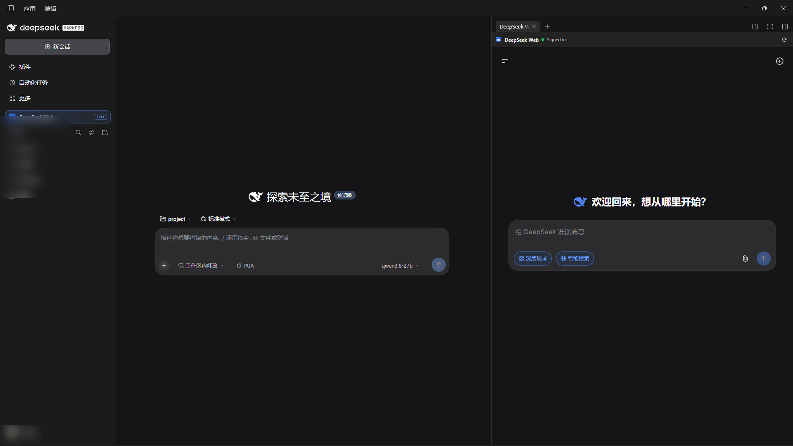

# dsh-plugin-deepseek-web

将 DeepSeek 网页版（`https://chat.deepseek.com`）接入 DSH 桌面端侧边栏的插件。



在左侧工作区上方加了一个 "DS" 图标，点击后用 Electron 的 `<webview>` 在右侧打开网页版。不消耗 API 额度，直接用网页端的会话，支持免登录重连和跟随宿主主题。

非官方插件，与 DeepSeek 官方无关。不涉及绕过任何登录或额度限制。

### 特性

- 用 Electron `<webview>` 替代 iframe，绕过 `frame-ancestors 'none'` 限制。
- 单击 DS 图标半屏打开，双击全屏，按 `Esc` 收起。
- 关掉面板不会销毁网页状态，再次打开还在原页面。
- 自动保存登录 Token，重启 DSH 后不用重新扫码。
- 网页的主题色会跟随 DSH 的深色/浅色模式切换。

### 安装

要求 DSH Desktop 版本在 `0.2.1-rc.3` 及以上。

如果插件已经上了插件市场，可以直接通过 CLI 装：

```bash
dsh plugin --profile desktop add dsh-plugin-deepseek-web
```

或者直接从 GitHub 安装：

```bash
dsh plugin --profile desktop add github:<owner>/dsh-plugin-deepseek-web
```

如果在本地调试源码，先 build 再 link：

```bash
pnpm install
pnpm build
dsh plugin --profile desktop add "link:$PWD"
```

装完后一定要彻底退出 DSH（包括托盘），然后重新启动。

### 开发

```bash
pnpm install
pnpm build   # 产物在 lib/
pnpm test    # 跑一遍 typecheck 和静态校验
```

**注意**：DSH 的客户端加载器不支持顶层 import/export，所以 `src/client.ts` 编译出来必须是单文件纯脚本，React 由宿主注入。另外，如果你要发布到 npm 或 GitHub，记得把 `lib/` 目录一起传上去，或者在 `package.json` 里配好 `"prepare": "pnpm build"` 脚本。DSH 宿主端没装 TypeScript，用户直接从远端拉代码是跑不起来的。

### 实现说明与踩坑记录

- **为什么不用 `persist:` 分区？**
  DSH 桌面端的私有桥 `window.dshDesktop.browser.acquire()` 给的是进程级随机内存分区，而且 `about:blank#<lease>` 和 partition 会有双向校验。如果自己强行覆盖成 `persist:`，租约验证会失败。
  目前的做法是在预热页提取 `userToken` 和 `__appKit_userInfo` 存到宿主 localStorage 里，下次启动提前注入。效果上等同于持久化。

- **Host 和 Client 的分工**
  Host 半部运行在 Node 环境，没有 DOM 权限；所以 `<webview>` 的创建、生命周期管理以及用 `executeJavaScript` 同步主题，全部都在 Client 半部里完成。Host 这边纯粹是个占位，满足 Cordis bundle 的结构。

- **已知限制**
  
  - 依赖了部分 DSH 和 DeepSeek 的内部实现，比如 `sidebarRightTabs`、槽位名和当前的 Token 存储结构。如果官方版本大更，可能需要适配。
  - 只有桌面端能用。Web 端没有 `dshDesktop.browser` 桥接，按钮会自动置灰。

### 安全说明

- 没有任何外发请求，不读 Harness 凭证，没加第三方统计。
- 网页的登录 Token 只存在你本机的 DSH localStorage 里。
- 网页本身跑在 Electron 默认的沙箱里，没有 Node 环境。

### License

MIT
